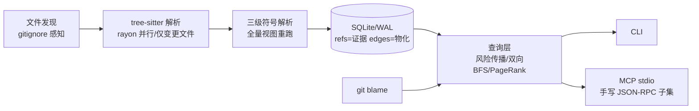

# codegraph

**确定、可解释、可溯源的代码知识图谱——不用向量库，每条检索结果附完整证据调用链。**
code knowledge graph · AST · tree-sitter · MCP · impact analysis · evidence chain

> 用 tree-sitter 把 TypeScript/JavaScript 仓库解析成可查询的调用图谱：
> 「改这个函数会影响哪些地方？」的答案不是语义相似的猜测，而是确定的调用闭包——
> 按风险排序，逐跳附源码位置，动态调用点显式标注为「间接影响」，绝不猜。

[](https://github.com/attnstack/codegraph/actions/workflows/ci.yml)
[](LICENSE)
[](https://www.rust-lang.org)
[](https://github.com/attnstack/codegraph/releases)


<!-- 首屏 demo 位：此处放 8-15s GIF（asciinema 录制 `codegraph impact` 真实输出），
     或 CLI 输出截图。录制命令：asciinema rec -c "codegraph impact src/services/payment.ts::charge" -->

## 30 秒 Quick Start

```bash
# 1. 安装（本地构建）
git clone https://github.com/attnstack/codegraph && cd codegraph
cargo build --release

# 2. 对任意 TS/JS 仓库建图（本仓库自带演示夹具）
./target/release/codegraph index --root fixtures/demo-app

# 3. 问它问题
./target/release/codegraph who-calls charge --root fixtures/demo-app
./target/release/codegraph impact charge --root fixtures/demo-app
./target/release/codegraph trace Checkout.createOrder format --root fixtures/demo-app
./target/release/codegraph hotspots --root fixtures/demo-app

# 4. 接入 Claude Code / Cursor 等 Agent（MCP stdio）
./target/release/codegraph mcp --root /path/to/your/repo
```

`who-calls charge` 的真实输出（fixtures/demo-app）：

```
`charge` (function) src/services/payment.ts:4
调用方（2 个，按限定名排序）:
  ◂ Checkout.createOrder  src/services/checkout.ts:5
      调用点 src/services/checkout.ts:7 (calls)
  ◂ RefundService.processRefund  src/services/refund.ts:9
      调用点 src/services/refund.ts:11 (calls)
```

## 为什么不是向量检索

| | 向量检索 | codegraph |
|---|---|---|
| 「谁调用了它」 | 语义相近 ≠ 真有调用关系 | **确定的调用边** |
| 结果可解释性 | 不知道为什么返回它 | **逐跳源码证据链** |
| 同样的查询 | 相似度波动 | **结果可复现** |
| 代码出库 | 通常要上传/索引到服务 | **纯本地，零外发** |
| 代价 | 需要嵌入模型 | 解析成本（用增量更新摊薄）+ 语言覆盖 |

## 特性

- **三级符号解析，不猜**：同文件 → import 链（含 barrel `export *` 转发、tsconfig paths
  别名、`.js`→`.ts` 惯例）→ 全局唯一导出兜底；遮蔽/歧义/内建全局/动态调用一律显式标记，
  宁缺毋滥——影响面分析里一个假调用方的代价是误导用户改错代码。
- **影响面分析 + 证据链**：反向调用闭包（测试/生成代码剪枝）+ 风险排序 +
  每个受影响节点的完整调用链（每跳有源码位置）。
- **增量 ≡ 全量，可证明**：重解析只做变更文件（贵），符号解析全量重跑（便宜），
  「增量结果 == 全量重建」由随机变异 fuzz 测试执行证明（双库全查询逐字段对比）。
- **MCP + CLI 双出口**：同一查询层，口径一致；MCP 用官方 TypeScript SDK 做契约测试。
- **代码考古**：git blame 定位符号的引入 commit、作者贡献度、PR 关联。

## 架构



详细设计（为什么解析全量重算、为什么 refs/edges 分表、为什么节点身份不含 span）：
[docs/ARCHITECTURE.md](docs/ARCHITECTURE.md)

## 核心算法

**影响面分析**（`impact`）：反向闭包 + Dijkstra 变体风险传播。

- 风险语义是「单源最优影响路径」：`risk(n) = max over in-edges (risk(p) × 0.8 × type_w)`，
  type_w：直接调用 1.0 / 继承重写 0.7 / 继承·实现 0.6。
- 为什么不是方案常见的 `Σ 所有路径`：有环图上路径数指数爆炸（#P-hard）；
  max 语义下权重单调递减保证松弛终止（环自动收敛），且父指针顺手重建最坏传播链作为证据。
- 剪枝：路径分段精确匹配（`tests`/`__tests__`/`generated`…）+ 文件名主干标记
  （`.test`/`.spec`）——刻意不用子串匹配（`latest.ts` 会被误杀）。
- 双熔断：深度 8 + 节点数 500，超限输出 `truncated` 标记。

**hotspots**：调用图上的加权 PageRank（边权=调用次数，跨文件 ×1.5），
悬空节点质量均匀回流，L1<1e-6 收敛。

**trace**：双向 BFS（出度小入度大，双向覆盖 O(b^{d/2}) 对 O(b^d)），每侧限深 5。

**增量一致性**：见 [docs/ARCHITECTURE.md](docs/ARCHITECTURE.md) D1，
测试见 `crates/codegraph-server/tests/fuzz_incremental.rs`。

## Benchmark

> 实测环境：Windows 11（10.0.26200）/ AMD Ryzen 7 7735H / 15.2 GB RAM / Rust 1.99.1（MinGW-w64 GCC 16.2，release 构建）。
> 测试集：`scripts/gen_corpus.py --seed 42` 合成 TS 语料（层级调用结构，单向无环），
> 规模 **700 文件 / 105,556 行 / 14,700 节点 / 32,825 边 / 31,428 引用**（`codegraph stats` 全量计数）。
> 测量方法：Python `perf_counter` + 子进程壁钟，7 次取中位数（`scripts/bench_run_once.py`）。
> 样本量 7、单机、未做统计显著性检验——数字用于量级判断，非精确承诺。复现：`bash scripts/bench.sh 700 20`。

| 指标 | 数值（中位数） | 说明 |
|---|---|---|
| 全量重建（10.5 万行，热缓存） | **767 ms** | 冷盘缓存首次 11.8 s（OS 页缓存效应，与程序无关） |
| 增量更新（单文件追加 1 行注释） | **871 ms** | 只重解析 1 个文件；代价在 DB 重写与全量视图拉平（见下） |
| `who-calls` | 186 ms | 含进程启动 + auto-refresh mtime 预筛 + 快照装载（算法本身 <5 ms） |
| `impact` | 188 ms | 同上；深度 8 / 节点上限 500 |
| `trace` | 187 ms | 双向 BFS 各限深 5 |
| `hotspots`（PageRank top10） | 208 ms | 迭代至 L1<1e-6 |
| `search` | 190 ms | SQL 精确 + 前缀 |
| `grep -rn` 文本基线 | 347 ms | ⚠️ 语义不对等：grep 找文本行不是调用边，仅作量级参照 |

**诚实结论**：在 10.5 万行规模，全量重建本身已 <1s，增量更新并不比它快——
tree-sitter 解析太便宜，本设计里增量的首要收益是**正确性等式**（增量 ≡ 全量，fuzz 证明），
性能收益出现在解析成本占比更高的场景（更大单文件、慢速磁盘、网络盘）。30K 行语料同构结果：
全量 643 ms / 增量 660 ms，关系一致。

## 项目不足（诚实清单）

1. **无类型信息**：JS/TS 语法级解析，receiver 类型未知的成员调用（`obj.method()`）
   大量落入 dynamic。改进路径：接入 tsc 类型表做四级消歧。
2. **动态语言特性覆盖有限**：装饰器路由、DI 容器、monkey-patch、`Proxy` 不可静态解析，
   全部归入 dynamic 呈现（不猜，但也不解决）。
3. **证据链是调用链不是程序切片**：不含数据依赖（参数/返回值流向），
   严格影响面需要 SDG。路线图：对 handler→service→DB 高频路径叠加数据流边。
4. **语言覆盖只有 TS/JS**：架构插件化（grammar + queries + 映射三步接入，
   见 CONTRIBUTING），但没有第二门语言的适配器实现。
5. **影响评估未考虑运行时频率**：PageRank 度量「结构重要性」，不含流量/日志权重。
6. **性能数字来自合成语料**：真实大型 monorepo（workspace 协议、多 tsconfig extends
   链）未回归，已知放大点记录在案。

## Contributing

见 [CONTRIBUTING.md](CONTRIBUTING.md)——含「如何添加一门语言」的三步指南。

## License

[MIT](LICENSE)
