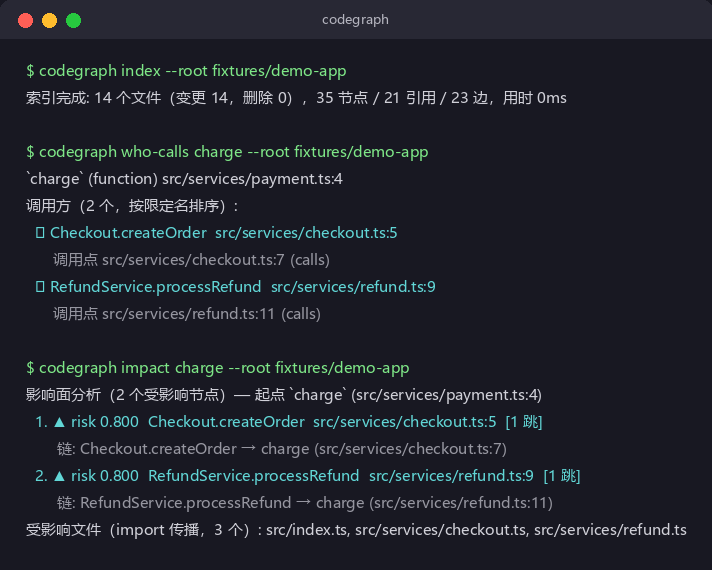
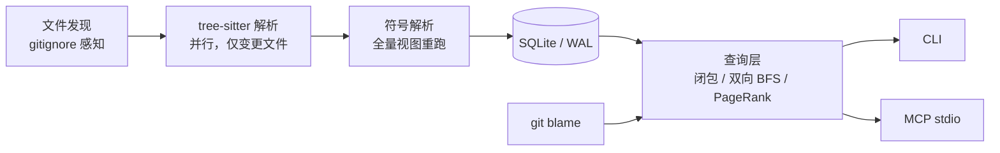

# codegraph

[中文](README.md) | [English](README_EN.md)

改一行代码，怎么知道会波及哪些地方？IDE 的"查找引用"只给一跳，全局搜索只会匹配文本。codegraph 用 [tree-sitter](https://tree-sitter.github.io/) 把整个 TypeScript/JavaScript（以及 Python）仓库解析成一张调用图（函数 / 类 / 文件 × 调用 / 继承 / 导入），然后直接回答：

- **谁调用了它** —— 每个调用点带源码位置
- **改它影响谁** —— 影响面按风险排序，每条附完整调用链
- **从入口到 DB/外部调用** 中间经过了谁

所有结论来自静态解析，每条边都能点回源码。解析不了的地方（动态调用、同名歧义、被局部变量遮蔽）会明确标成 dynamic 列出来，而不是硬塞一个可能错的答案给你。不需要向量库，不需要上传代码，查询结果可复现。

[](https://github.com/attnstack/codegraph/actions/workflows/ci.yml)
[](LICENSE)



## 快速上手

```bash
git clone https://github.com/attnstack/codegraph.git && cd codegraph
cargo build --release

# 对任意 TS/JS 仓库建图（仓库自带一个演示项目）
./target/release/codegraph index --root fixtures/demo-app

# 问它问题
./target/release/codegraph who-calls charge --root fixtures/demo-app
# 开发态：保存即自动增量重建（可另开一个终端挂着）
./target/release/codegraph watch --root fixtures/demo-app
./target/release/codegraph impact charge --root fixtures/demo-app
./target/release/codegraph trace Checkout.createOrder format --root fixtures/demo-app
./target/release/codegraph callees charge --root fixtures/demo-app      # 它调用了谁
./target/release/codegraph dead-code --root fixtures/demo-app           # 孤儿函数
./target/release/codegraph cycles --root fixtures/demo-py               # import 循环（python 仓库）
./target/release/codegraph hotspots --root fixtures/demo-app
```

Python 仓库用法完全一样——试试 `--root fixtures/demo-py`。

`impact` 的输出长上面截图那样：按风险排序的受影响清单 + 每条的证据链。风险分的算法在[架构文档](docs/ARCHITECTURE.md)里，一句话版本是"沿调用链每跳衰减 0.8，不同边类型不同权重"。

## 接入 Claude Code / Cursor

CLI 之外还有一个 MCP stdio 出口，Agent 可以直接调用同一套查询：

```json
{
  "mcpServers": {
    "codegraph": {
      "command": "/path/to/codegraph",
      "args": ["mcp", "--root", "/path/to/your/repo"]
    }
  }
}
```

不想装 Rust 工具链的话，仓库带了 Dockerfile：

```bash
docker build -t codegraph .
docker run -i --rm -v /path/to/your/repo:/repo codegraph        # 起 MCP stdio
docker run --rm -v /path/to/your/repo:/repo codegraph index --root /repo   # 当 CLI 用
```

提供 9 个工具：`who_calls` / `impact` / `trace` / `callees` / `dead_code` / `cycles` / `hotspots` / `search` / `archaeology`。改完文件不用手动重建——每次工具调用前会做 mtime/size 预筛，发现漂移自动增量更新。协议实现是手写的最小 JSON-RPC 子集，用官方 TypeScript SDK 做了[契约测试](tests-ts/)（这也是 CI 的一部分）。

`archaeology` 单独说一下：基于 `git blame -C` 做代码考古，输入一个符号，返回它每行是哪个 commit 引入的、谁写的、关联哪个 PR。接手别人的老模块时挺好用。

## 为什么不用向量库

语义相似不等于真有调用关系。改代码影响评估需要的是确定的边，不是"感觉相关的前 k 个"。代价也很实在：解析成本（靠增量更新摊薄）和语言覆盖（目前只有 TS/JS）。如果你要的是"帮我找实现某个业务概念的代码"，这是另一类问题，embedding 检索更合适，两者不冲突。

## 工作原理



几个关键取舍（细节在 [docs/ARCHITECTURE.md](docs/ARCHITECTURE.md)）：

- **节点身份不含行号**。span 只是属性，否则每编辑一次全部节点 id 洗牌，增量更新就没法做了。
- **每个调用点单独存一行（refs 表）**，边表只是聚合缓存。证据链、增量重解析的原材料，都是同一份 refs。
- **增量的正确性靠拆分**：tree-sitter 解析（贵）只做变更文件；符号解析（便宜，全是哈希查找）每次对全量视图重跑。所以"增量结果 == 全量重建"能拿 fuzz 测试证明——随机改文件，两边各查一遍全部符号，逐字段断言相等。这个测试在 CI 里跑。

## 性能

我机器上（Ryzen 7 7735H，Windows 11，release 构建）跑合成语料（700 个文件、10.5 万行、1.5 万节点 / 3.3 万边）：

| 操作 | 耗时 |
|---|---|
| 全量重建 | 0.77s |
| 单文件变更增量更新 | 0.87s |
| 各查询命令 | 0.19–0.21s |

查询那 0.2s 基本是进程启动和快照装载，算法本身毫秒级。同目录 `grep -rn` 一遍要 0.35s，而且它只能给你文本行。

说句实话：这个规模下全量重建本来就不慢，增量并不比它快。增量的价值在于正确性模型（上面说的 fuzz 等式）和更大的语料/更慢的磁盘。数字怎么测的、怎么复现，见 `scripts/bench.sh`。

## 已知不足

- JS 没有类型信息，`obj.method()` 这类调用很多解析不出来，进了 dynamic 桶。要彻底解决得接 tsc 的类型表，暂时没做。
- 装饰器路由、DI 容器、monkey-patch 这类运行时魔法，静态分析原则上无解，全部如实标 dynamic。
- 证据链是调用链，不含数据流。严格的影响面要程序切片（SDG），是后面想做的方向。
- 语言适配器覆盖 TS/JS 和 Python。加一门语言 = 一个 grammar 依赖 + 一份 queries 文件 + 在 parse.rs 注册（见 [CONTRIBUTING](CONTRIBUTING.md)）；python 的 import 环检测也顺带做了，但 barrel 式 re-export 链目前只在 TS 侧支持。
- benchmark 用的是合成语料，真实大型 monorepo（workspace 协议、多层 tsconfig extends）没回归过。

## 更新日志

版本历史见 [CHANGELOG.md](CHANGELOG.md)。

## License

[MIT](LICENSE)
