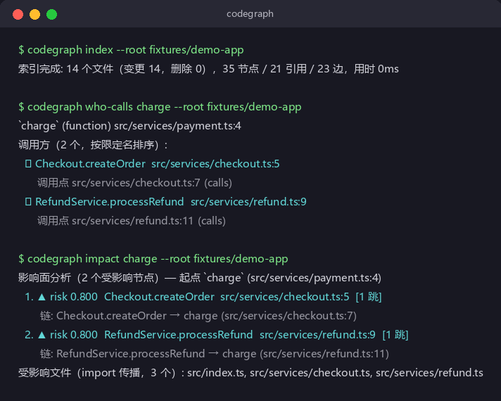
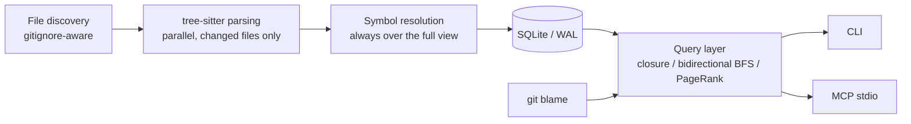

# codegraph

[中文](README.md) | English

What breaks when you change a line of code? IDE "find references" gives you one hop, and text search just matches strings. codegraph parses an entire TypeScript/JavaScript **or Python** repository into a call graph (functions / classes / files × calls / inheritance / imports) with tree-sitter, then answers directly:

- **Who calls it** — every call site cites a source location
- **What breaks if I change it** — affected symbols ranked by risk, each with a full evidence chain
- **From entry point to DB/external call** — who is in between

Every conclusion comes from static parsing and points back to source. Things static analysis can't resolve (dynamic calls, ambiguous names, shadowed locals) are explicitly reported as `dynamic` instead of being guessed. No vector database, no code upload, reproducible results.

[](https://github.com/attnstack/codegraph/actions/workflows/ci.yml)
[](LICENSE)



## Quick start

```bash
git clone https://github.com/attnstack/codegraph.git && cd codegraph
cargo build --release

# Index any TS/JS/Python repo (a small demo repo ships with the project)
./target/release/codegraph index --root fixtures/demo-app

# Ask questions
./target/release/codegraph who-calls charge --root fixtures/demo-app
# dev mode: auto-rebuild on save (run in a second terminal)
./target/release/codegraph watch --root fixtures/demo-app
./target/release/codegraph impact charge --root fixtures/demo-app
./target/release/codegraph trace Checkout.createOrder format --root fixtures/demo-app
./target/release/codegraph callees charge --root fixtures/demo-app      # downstream
./target/release/codegraph dead-code --root fixtures/demo-app           # orphan functions
./target/release/codegraph cycles --root fixtures/demo-py               # import cycles
./target/release/codegraph hotspots --root fixtures/demo-app            # weighted PageRank
```

Python repos work the same way — try `--root fixtures/demo-py`.

The `impact` output looks like the screenshot above: risk-ranked affected symbols plus the evidence chain for each. The scoring is "decay 0.8 per hop along the call chain, different weights per edge type" — details in the [architecture doc](docs/ARCHITECTURE.md).

## Use with Claude Code / Cursor

Besides the CLI there's an MCP stdio server, so agents call the same query layer:

```json
{
  "mcpServers": {
    "codegraph": {
      "command": "/path/to/codegraph",
      "args": ["mcp", "--root", "/path/to/your/repo"]
    }
  }
}
```

9 tools: `who_calls` / `impact` / `trace` / `callees` / `dead_code` / `cycles` / `hotspots` / `search` / `archaeology`. No manual re-index after edits — every tool call runs an mtime/size pre-check and incrementally rebuilds when the tree drifted. The protocol is a hand-written minimal JSON-RPC subset, validated by [contract tests](tests-ts/) that drive it with the official TypeScript SDK (part of CI).

`archaeology` deserves a mention: git-blame based code archaeology — given a symbol, it reports which commit introduced each line, who wrote it, and the linked PR.

## Why not vector search

Semantic similarity is not a real call relationship. Change-impact analysis needs definite edges, not "top-k things that feel related". The cost is parsing time (amortized by incremental updates) and language coverage (TS/JS and Python for now). If you're looking for "find code implementing this business concept", that's a different problem — embedding search fits it better, and the two approaches don't conflict.

## How it works



Key decisions (details in [docs/ARCHITECTURE.md](docs/ARCHITECTURE.md)):

- **Node identity excludes line numbers.** Spans are attributes; otherwise every edit reshuffles all node ids and incremental updates become meaningless.
- **Every call site is a row (refs table)**; the edge table is just an aggregated cache. Evidence chains and the raw material for incremental re-resolution are the same refs.
- **Incremental correctness by decomposition**: tree-sitter parsing (expensive) runs only on changed files; symbol resolution (cheap, all hash lookups) reruns over the full view every time. So "incremental == full rebuild" is provable by a fuzz test — mutate files at random, run every query on both graphs, assert field-by-field equality. It runs in CI.

## Performance

On my machine (Ryzen 7 7735H, Windows 11, release build) over a synthetic corpus (700 files, 105K lines, 14.7K nodes / 33K edges):

| Operation | Time |
|---|---|
| Full rebuild | 0.77s |
| Incremental update (one file changed) | 0.87s |
| Any query | 0.19–0.21s |

The 0.2s per query is mostly process startup and snapshot loading; the algorithms themselves are millisecond-scale. `grep -rn` over the same tree takes 0.35s and only gives you text lines.

Honestly: at this scale a full rebuild is fast enough that incremental isn't faster. The point of the incremental design is the correctness model (the fuzz equation above) and bigger/colder corpora. How the numbers were measured: `scripts/bench.sh`.

## Known limitations

- JS has no type information, so many `obj.method()` calls land in the dynamic bucket. Fixing that properly means wiring in tsc types — not done yet.
- Decorator routing, DI containers, monkey-patching: static analysis can't resolve these by principle; they're all honestly reported as dynamic.
- Evidence chains are call chains, not data flow. Strict impact analysis wants program slicing (SDG) — that's the next direction.
- Language adapters exist for TS/JS and Python. Adding one = a grammar dependency + a queries file + registration in parse.rs (see [CONTRIBUTING](CONTRIBUTING.md)); the architecture is pluggable.
- Benchmarks use a synthetic corpus; real large monorepos (workspace protocols, multi-level tsconfig extends) haven't been regression-tested.

## Changelog

See [CHANGELOG.md](CHANGELOG.md) (Chinese).

## License

[MIT](LICENSE)
